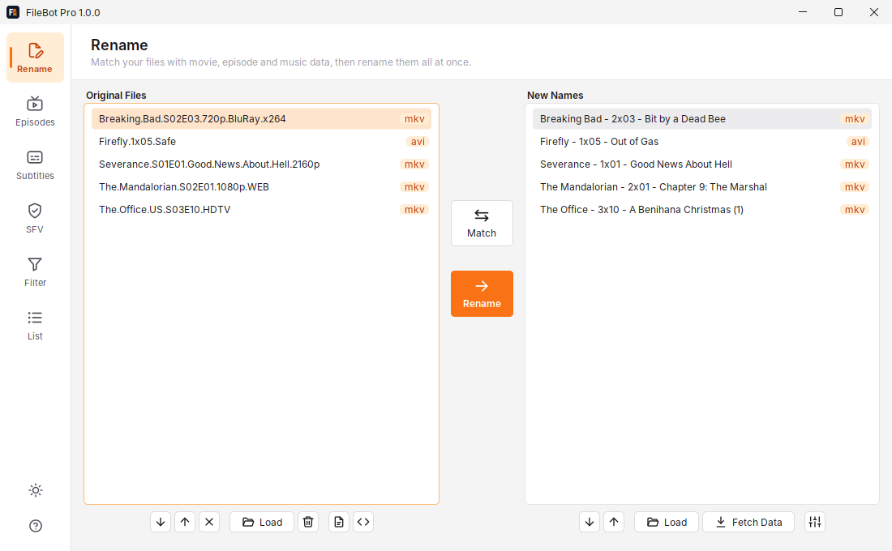
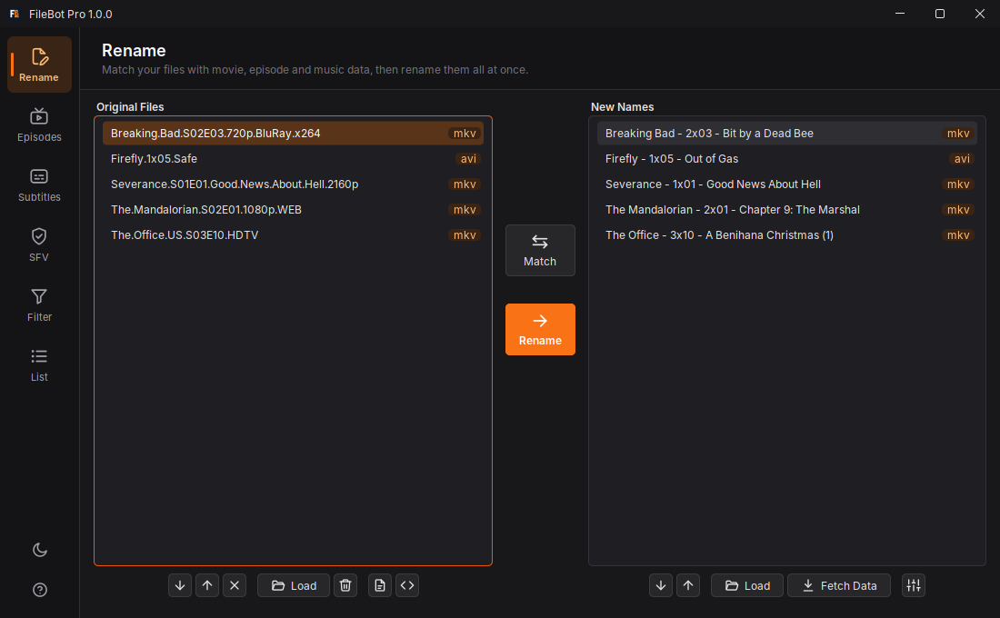

<p align="center">
  
</p>

<h1 align="center">FileBot Pro</h1>

<p align="center">
  <b>Organize and rename your movies, TV shows and anime with a modern, animated interface.</b><br>
  📚 <a href="https://filebotpro.davamu.dev">Documentation: filebotpro.davamu.dev</a>
</p>

<p align="center">
  
  
  
  
  
  
</p>

<p align="center">
  
  
</p>

## Features

- 🎬 **Smart renaming** — match files against TheMovieDB, TheTVDB, TVmaze, AniDB, OMDb and AcoustID, then rename, copy or link them.
- 🧩 **Format expressions** — Groovy naming schemes (`{n} - {s00e00} - {t}`) with live preview and presets.
- 💬 **Subtitles** — search and download (OpenSubtitles) by hash or name.
- ✅ **Checksums** — create and verify SFV, MD5, SHA-1, SHA-256 and SHA3-384.
- 🗂️ **Filter tools** — inspect media properties, extract archives, split and organize folders.
- 💻 **CLI & scripting** — everything is scriptable, including built-in `fn:` scripts such as `fn:amc` to sort downloads into your library.
- 🌗 **Light, dark & system theme** with an animated, FlatLaf-based UI.

## Install

Download the packages from [GitHub releases](https://github.com/davamudev/filebot-pro/releases). Every download bundles its own Java runtime. Step-by-step instructions for each system are in the [installation guide](https://filebotpro.davamu.dev/getting-started/installation/).

| System | Download | Install |
|---|---|---|
| Windows 10/11 | `FileBot-Pro-<version>-windows-portable.zip` or `.msi` (`-windows-arm64-portable.zip` for ARM) | Unzip and start `FileBot Pro.exe`, or run the installer |
| Ubuntu / Debian | `filebot-pro_<version>-1_amd64.deb` | `sudo apt install ./filebot-pro_<version>-1_amd64.deb` |
| Fedora / openSUSE | `filebot-pro-<version>-1.x86_64.rpm` | `sudo dnf install ./filebot-pro-<version>-1.x86_64.rpm` |
| Other Linux | `FileBot-Pro-<version>-linux-portable.zip` | Unzip and run `bin/FileBot Pro` |
| macOS | `FileBot Pro-<version>-arm64.dmg` (Apple Silicon) or `-x64.dmg` (Intel) | Drag the app into **Applications** |
| Synology DSM 7 | `FileBot-Pro-<version>-synology-x86_64.spk` or `-armv8.spk` | **Package Center → Manual Install** (command line) |

The `.deb` and `.rpm` packages put the `filebot-pro` command on the `PATH` and pull in MediaInfo, fpcalc, mkvpropedit and AtomicParsley as recommended packages.

## Build from source

Requires **JDK 25** to build (Gradle downloads one if missing). On Windows use `gradlew.bat`.

```bash
./gradlew buildAll       # everything for this platform: CLI, portable zip, installer and docs
./gradlew run            # run from source
./gradlew installDist    # command line -> build/install/filebot-pro/bin/filebot-pro
./gradlew portableZip    # portable build with bundled Java -> build/distributions/
./gradlew jpackage       # native installer -> build/jpackage/installer/
./gradlew docsBuild      # documentation site -> docs/dist/ (needs Node.js)
```

`jpackage` builds `.msi` on Windows (needs [WiX](https://wixtoolset.org/)), `.dmg` on macOS and `.deb` on Linux; change it with `-PinstallerType=exe|pkg|rpm`. Installers can only be built on their own system (`.deb`/`.rpm` on Linux, `.dmg`/`.pkg` on macOS). The Linux package templates live in [`packaging/linux`](packaging/linux); set `app.maintainerEmail` in `gradle.properties` for the `.deb` Maintainer field.

## API keys

Application keys are embedded at build time and are not part of the repository. Register your own (most are free for personal use):

```bash
cp api-keys.properties.example api-keys.properties   # git-ignored, then fill in your keys
```

| Key | Service | Used for | Embedded |
|---|---|---|---|
| `themoviedb` | [TheMovieDB](https://www.themoviedb.org/settings/api) | Movies, TV, artwork (required for movies) | Yes |
| `thetvdb` | [TheTVDB](https://thetvdb.com/api-information) | TV episodes | Yes |
| `anidb` | [AniDB](https://anidb.net/software/add) | Anime episodes | Yes |
| `opensubtitles` | [OpenSubtitles](https://www.opensubtitles.com/en/consumers) | Subtitles (REST API key; 5 downloads per day without login, more with the user's own account) | Yes |
| `acoustid` | [AcoustID](https://acoustid.org/new-application) | Music fingerprinting | Yes |
| `fanart.tv` | [Fanart.tv](https://fanart.tv/get-an-api-key/) | Artwork | Yes |
| `omdb` | [OMDb](https://www.omdbapi.com/apikey.aspx) | IMDb ratings | No |
| `google.geocode` | [Google Geocoding](https://developers.google.com/maps/documentation/geocoding) | Photo locations | No |

TVmaze and local metadata need no key. `omdb` and `google.geocode` are never embedded, because their quota, licensing or billing is tied to the key: users who want these services add their own key at runtime.

This product uses the TMDB API but is not endorsed or certified by [TMDB](https://www.themoviedb.org). The attribution of all
data sources is shown in the app under **Help → About FileBot Pro**. Keys can be overridden without rebuilding, in this order: `-Dapikey.<name>=…`, the `FILEBOT_PRO_APIKEY_<NAME>` environment variable (also read at build time), or `api-keys.properties` in the user data folder.

## Optional native tools

| Tool | Enables | Windows | macOS | Linux |
|---|---|---|---|---|
| MediaInfo | `{vf}`, `{af}`, `{resolution}`, … | `./gradlew downloadNativeTools` | `brew install libmediainfo` | `apt install libmediainfo0v5` |
| fpcalc | AcoustID music matching | `./gradlew downloadNativeTools` | `brew install chromaprint` | `apt install libchromaprint-tools` |
| mkvpropedit, AtomicParsley | `--apply metadata` (tags and cover in mkv and mp4 files) | `./gradlew downloadNativeTools` | `brew install mkvtoolnix atomicparsley` | `apt install mkvtoolnix atomicparsley` |

On Windows, downloaded tools are bundled by the next `portableZip` / `jpackage`. On Linux the `.deb` / `.rpm` packages recommend them, so `apt` / `dnf` install them automatically.

## Command line

Every build includes a `filebot-pro` command: `filebot-pro.exe` next to `FileBot Pro.exe` on Windows, `/usr/bin/filebot-pro` with the `.deb` / `.rpm` packages, `bin/filebot-pro` in the Linux portable folder and `FileBot Pro.app/Contents/MacOS/FileBot Pro` on macOS (from source: `./gradlew installDist`, then `build/install/filebot-pro/bin/filebot-pro`). Without arguments it opens the desktop app; on Linux it also runs without a desktop session, e.g. over SSH.

```bash
filebot-pro -rename "/media/TV" -r --db TVmaze --action test --format "{n}/Season {s}/{n} - {s00e00} - {t}"
filebot-pro -script fn:amc "/downloads/complete" --output "/media" --action move -non-strict
filebot-pro -script fn:sysinfo
```

`filebot-pro -help` lists all options; see the [command line reference](https://filebotpro.davamu.dev/reference/command-line/).

## Configuration

- **User data** (settings, history, caches, logs): `%APPDATA%\FileBot Pro`, `~/Library/Application Support/FileBot Pro` or `~/.filebot-pro`. Override with `-Dapplication.dir=<folder>`.
- **Theme**: `-Ddev.davamu.filebotpro.theme=light|dark|system`; disable animations with `-Dflatlaf.animation=false`.

## Roadmap

Next up: an APT repository (`apt install filebot-pro`) and Windows Explorer integration. See [ROADMAP.md](ROADMAP.md). Each version tag publishes the packages to GitHub releases and the Docker image to GHCR.

## Development

Open the folder in IntelliJ IDEA as a Gradle project. Other useful tasks: `compileJava`, `generateIcons`, `updateData`, `bashCompletion`. The documentation site lives in [`docs/`](docs/README.md). See [CHANGELOG.md](CHANGELOG.md) for changes and [ROADMAP.md](ROADMAP.md) for planned work.

## Contributing

Open pull requests against `develop`. Commit messages and PR titles follow [Conventional Commits](https://www.conventionalcommits.org/). See [CONTRIBUTING.md](CONTRIBUTING.md) for details.

## License

FileBot Pro is a fork of [FileBot](https://www.filebot.net) **4.7.9** by Reinhard Pointner, the last release published as free software under the GNU General Public License. As a derivative work it is distributed under the same terms, the [GNU General Public License v3.0](LICENSE.md), so it is fully legal to use and share. Modifications © 2026 [DaVaMu](https://davamu.dev).

You are free to:

- use it for any purpose, including commercially;
- study and modify the source code;
- redistribute it, original or modified, as source or binaries;
- fork it and contribute back — pull requests are welcome.

When you distribute it, keep it under the GPL-3.0, make the source code available and preserve the copyright and license notices.

The built-in `fn:` scripts are based on the GPL-3.0 [FileBot scripts](https://github.com/filebot/scripts). Bundled libraries, data and native tools keep their own licenses, see [THIRD_PARTY_NOTICES.md](THIRD_PARTY_NOTICES.md). FileBot Pro is an independent project and is not affiliated with or endorsed by FileBot or its author.
